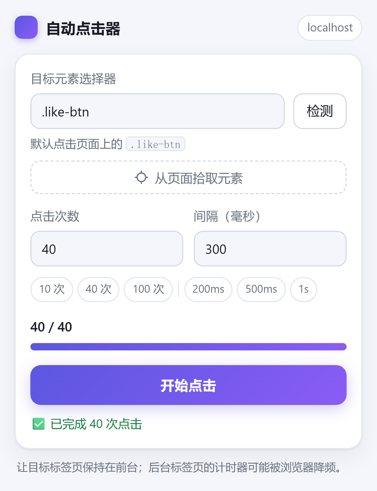

# 自动点击器 · Chrome 扩展

在任意网页上按设定的**点击次数**和**间隔**自动点击指定元素，默认就是 `.like-btn`。
适合 B 站直播间点赞这类需要连续点击的场景，也能用在任何带可点击按钮的页面上。
带实时进度、预计剩余时间、随时停止，并且**关掉弹窗后任务继续运行**。



## 功能

- 目标元素用 CSS 选择器指定，默认 `.like-btn`
- 点击次数（1–100000）与间隔（50 毫秒–10 分钟）均可设置，附带常用预设
- 实时进度条、`已点击 / 总次数`、预计剩余时间
- 一次点击进行中可随时「停止点击」
- 工具栏图标上显示已点击次数，弹窗关掉也能看到进度
- 计时器跑在页面里，弹窗关闭不影响任务；再次打开弹窗会恢复显示进度
- 设置自动保存，下次打开沿用上次的配置
- 「从页面拾取元素」：像 F12 一样在页面上直接点选，自动生成 CSS 选择器
- 「检测」按钮可确认选择器匹配到几个元素，并区分主文档 / Shadow DOM / iframe
- 点击可穿透 open Shadow DOM 与同源 iframe，不再只查主文档
- 权限只申请 `activeTab` / `scripting` / `storage`，不读取账号或浏览数据

## 安装

1. 打开 `chrome://extensions/`（Edge 用 `edge://extensions/`）
2. 打开右上角的「开发者模式」
3. 点击「加载已解压的扩展程序」，选择本目录 `chrome-auto-clicker`
4. 把扩展图标固定到工具栏，方便随时打开

## 使用

1. 打开目标网页，等页面加载完
2. 点击工具栏上的扩展图标
3. 填写选择器、点击次数、间隔（可先点「检测」确认能匹配到元素）
4. 不知道选择器就点「从页面拾取元素」：弹窗会关闭，鼠标变成准星，悬停时有高亮框，点一下目标按钮即可
5. 点击「开始点击」即可，弹窗可以关掉
6. 需要中断时再打开弹窗点「停止点击」

> 拾取后重新打开弹窗，选择器会自动填好并检测一次；之所以要重开，是因为 Chrome 的扩展弹窗在点击页面时会自动关闭。

## 参数说明

| 参数 | 默认值 | 范围 | 说明 |
| --- | --- | --- | --- |
| 目标元素选择器 | `.like-btn` | 任意合法 CSS 选择器 | 每次触发时重新查找，元素是懒加载也没问题 |
| 点击次数 | 40 | 1–100000 | 达到次数后自动结束 |
| 间隔 | 500 毫秒 | 50–600000 毫秒 | 两次点击之间的等待时间 |

## 选择器怎么写

| 场景 | 写法 |
| --- | --- |
| 按类名 | `.like-btn` |
| 按 id | `#like-button` |
| 按属性 | `button[data-testid="like"]` |
| 限定位置 | `.post:first-child .like-btn` |
| 多个候选之一 | `.like-btn, .vote-btn` |

写完可以点弹窗里的「检测」，或者在页面控制台执行
`document.querySelectorAll('.like-btn')` 验证。

## 检测不到元素？

「检测」提示没有匹配元素，说明页面里确实找不到符合选择器的元素，按这个顺序排查：

1. **类名不对（最常见）**：`.like-btn` 只是示例代码里的占位类名。直接点弹窗里的「从页面拾取元素」，在页面上点中目标按钮，选择器会自动生成。
2. **元素在跨域 iframe 里**：扩展读不到跨域 iframe 的内容，检测会提示「有 N 个跨域 iframe」，这种情况只能改用主文档里的元素。
3. **元素还没渲染**：无限滚动、点击展开、登录后才出现的按钮，等页面滚到位置、元素出现后再点「检测」。
4. **页面受限**：`chrome://`、扩展商店、PDF 阅读器等页面禁止注入脚本。

如果元素在 open Shadow DOM 或同源 iframe 里，检测会直接标出来（`Shadow DOM 1` / `iframe 1`），拾取和点击也会自动穿透过去。

## 工作原理

```
点击扩展图标 → popup.html / popup.js
                   │  chrome.scripting.executeScript 注入 pageClicker
                   ▼
              页面内的 setInterval 循环
                   │  querySelector(选择器) → click()
                   │  chrome.runtime.sendMessage 回传进度
                   ▼
       popup.js 显示进度    background.js 写入 storage
```

计时器属于页面，不属于弹窗，所以关掉弹窗任务不会停；页面刷新或跳转时脚本随页面销毁，任务自然结束。

## 文件结构

```
chrome-auto-clicker/
├── manifest.json      # MV3 清单：权限、图标、弹窗入口
├── background.js      # 记录每个标签页的任务状态，处理导航/关页
├── popup.html         # 弹窗界面
├── popup.css          # 弹窗样式（跟随系统深色模式）
├── popup.js           # 配置校验、注入、页面拾取、进度展示、停止逻辑
├── icons/             # 16 / 48 / 128 图标
├── docs/popup.png     # 界面截图
└── demo/index.html    # 本地测试页，带一个 .like-btn
```

## 本地试用

```powershell
cd chrome-auto-clicker\demo
python -m http.server 8000
```

浏览器打开 <http://localhost:8000>，装上扩展后点「开始点击」，页面上的计数会随之增加。

## 注意事项

- **后台标签页会被限速**：浏览器会把隐藏标签页的 `setInterval` 降到约 1 次/秒，建议让目标页保持在前台，或者把间隔设大一些。
- **页面跳转会中断**：刷新、导航、关闭标签页后脚本随之销毁，任务结束；进度会标记为「页面跳转」或「任务已中断」。
- **受限页面无法运行**：`chrome://`、扩展商店、内置 PDF 阅读器等页面禁止注入，弹窗会直接提示。
- **跨域 iframe 读不到**：同源 iframe 和 open Shadow DOM 已支持；跨域 iframe 的内容扩展无法访问，检测时会提示「有 N 个跨域 iframe」。
- **切换语义的按钮**：有些网站的点赞按钮是「开/关」切换，连续点击会取消点赞，请按需设置次数。
- **合规使用**：请遵守目标网站的服务条款，只在自己有权操作的页面上使用。

## 二次开发

- 改默认值：`popup.js` 顶部的 `DEFAULT_SETTINGS`
- 改主题色和布局：`popup.css` 顶部的 CSS 变量
- 点击逻辑本身在 `popup.js` 的 `pageClicker()` 里，页面拾取器在 `pagePicker()` 里，改动后重新加载扩展即可（`chrome://extensions/` 里点刷新按钮）
